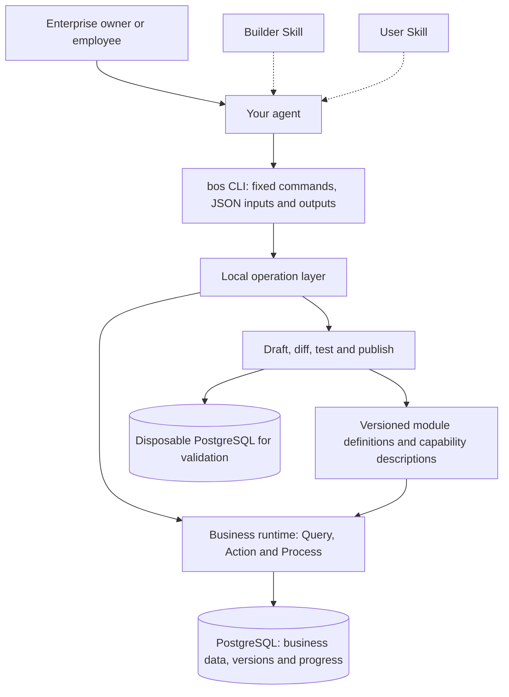

# BusinessOS

English · [简体中文](README.zh-CN.md)

**An AI-native business system for people and agents, built around shared data, explicit rules and versioned modules.**

BusinessOS starts with AI-native startups where employees and agents work in the same company. Both need a shared record of contracts, purchases, budgets and other business, with rules that hold across every operation. The long-term ambition is to offer an AI-native alternative to enterprise systems such as SAP and Oracle. This repository is an early, runnable local preview.

## How it works

An enterprise starts from a template, adapts it, or develops a new module. A module groups business tables, queries, actions and processes. The current preview includes contract and procurement definitions and an installable expense-submission starter.

Two skills guide your existing coding agent through the same CLI:

| Skill | Job | Example |
|---|---|---|
| **Builder** | Develop, install, test and publish business modules and rules. | “New contracts above CNY 40,000 need a cost assessment before signing.” |
| **User** | Discover available capabilities, query data and carry out business operations. | “Find this contract and sign it after its required assessment.” |

After Builder publishes a capability, User can discover its description and parameters through the CLI. Adding a module does not require rewriting the User skill or adding a bespoke CLI command. The runtime checks permissions and business conditions when an operation executes.

The conversation happens in your chosen agent, such as Codex. This repository provides the business runtime, CLI and skills; it does not include a standalone chat application.

## Architecture



The current implementation is a **Python monolith**. The CLI uses `argparse`, calls a local operation layer, and reaches PostgreSQL through `psycopg`. There is no HTTP service. Module definitions use JSON; implementation comes from registered Python handlers, restricted expressions and a declarative record-creation handler.

| Concept | Meaning |
|---|---|
| **Object** | One real business table, with fields and references. |
| **Query** | An authorized, read-only operation. |
| **Action** | A business operation with permission and state checks, executed transactionally. |
| **Process** | A definition that organizes actions and durable waits. |

Modules group these definitions. Approvals and similar work items are ordinary business records. The current process interpreter exercises the procurement workflow; it is not a complete general-purpose workflow engine.

See the [technical architecture](docs/ARCHITECTURE.md) for execution, storage and release mechanics, and the [CLI contract](docs/CLI.md) for commands and module artifacts.

## Develop a rule, then use it

```text
Builder reads the current enterprise definition
  → prepares a candidate and independent acceptance cases
  → reviews the diff and tests in disposable PostgreSQL
  → publishes against the expected base version
  → User discovers the published capability and calls it
```

Publication reruns the cases and checks the base under the activation lock. Capability descriptions and business definitions become visible in the same release. Supported existing records and processes retain their business version, while execution checks current authorization.

For example, the persistent walkthrough changes the contract-assessment threshold to CNY 40,000, checks the boundary and old contracts, then installs expense submission. An employee can discover and use `expense.submit` without changing the CLI or User skill.

## Try it locally

Run as a regular user with Python 3.10+, `venv`, PostgreSQL server tools (`initdb` and `pg_ctl` on `PATH`), and libpq. If needed, add the installed PostgreSQL `bin` directory to `PATH`.

```sh
git clone https://github.com/CongQIANFN/businessos.git
cd businessos
sh run-demo.sh
sh run-cli-demo.sh
```

The first command prepares the Python environment and runs a disposable contract/purchase demo. The second runs the Builder-to-User walkthrough and leaves a **stopped, persistent** instance in `.businessos/`. Both use synthetic data and prepared artifacts; no model API key is required.

Continue with that instance:

```sh
./bos instance start
./bos context show
./bos --identity employee action list
./bos --identity employee action describe expense.submit
./bos instance stop
```

The walkthrough requires a fresh instance directory. Set `BOS_HOME=/absolute/new/path` to select another one; initialization never overwrites an existing instance. For manual setup, use `./bos instance init` instead of `run-cli-demo.sh` after preparing dependencies.

Use the repository's [Builder skill](.agents/skills/businessos-builder/SKILL.md) and [User skill](.agents/skills/businessos-user/SKILL.md) with your agent. If it does not discover project-local skills, copy those folders into its skill directory. Skills guide the agent; they do not grant permissions.

## Verification and current scope

```sh
experiments/procurement/.venv/bin/python tests/cli_acceptance.py
sh experiments/procurement/run.sh
sh experiments/builder/run.sh
sh experiments/billing/run.sh
```

The [recorded acceptance](docs/ACCEPTANCE.md) includes 50 CLI checks plus the procurement, Builder and billing experiments. It covers rule boundaries, old-record versions, permissions, retries, competing releases, new capability discovery and restart persistence. Billing is a separate shared-runtime experiment, not a module preinstalled by the CLI initializer.

This is a local engineering preview. Identity switching is a synthetic fixture, PostgreSQL uses local trust authentication with fsync disabled, and host access and Python handlers are trusted. Remote authentication, arbitrary module-code uploads, robust code isolation, comprehensive field-level permissions and real external integrations remain future work. The release activation and change receipt are separate transactions; recovery across that crash window is unfinished. The older experimental Builder wrapper remains a sample-specific regression fixture.

## Project map

| Path | Purpose |
|---|---|
| `bos`, `businessos/` | CLI and local operation layer. |
| `.agents/skills/` | Builder and User instructions. |
| `templates/`, `examples/` | Expense starter, acceptance cases and walkthrough. |
| `experiments/procurement/` | Shared PostgreSQL runtime and procurement experiment. |
| `experiments/builder/`, `experiments/billing/` | Rule-change and billing experiments. |
| `tests/`, `docs/` | CLI acceptance, architecture and command documentation. |

See [AGENTS.md](AGENTS.md) for development conventions.

## License

[MIT](LICENSE)
