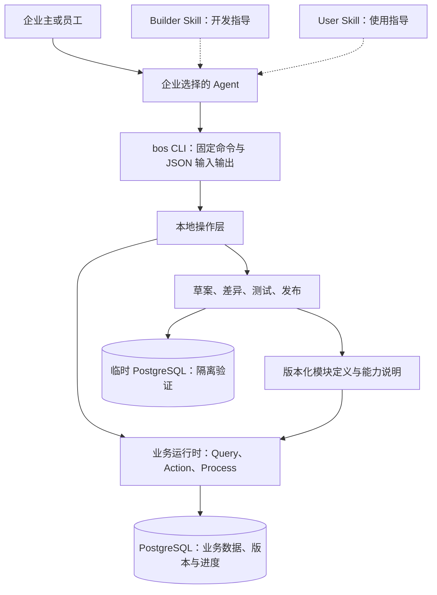

# BusinessOS

[English](README.md) · 简体中文

**面向人和 AI Agent 的企业业务系统：共享数据、遵守明确规则，并通过版本化模块持续演进。**

BusinessOS 首先服务 AI-native 创业公司。在这样的公司里，员工和 Agent 一起处理合同、采购、预算等业务，需要共用业务数据，并在每次操作时遵守企业规则。项目的长期愿景，是提供能够替代 SAP、Oracle 等传统企业系统的 AI-native 方案。这个仓库目前是一个早期、可运行的本地预览。

## 产品怎样使用

企业可以选择模板直接开始、修改模板，或开发新的业务模块。模块组织业务表、查询、动作和流程。当前预览包含合同、采购定义，以及可以安装的报销提交模板。

两个 Skill 指导企业已有的 Agent，通过同一套 CLI 开展工作：

| Skill | 职责 | 需求示例 |
|---|---|---|
| **Builder** | 开发、安装、测试和发布业务模块及规则。 | “新合同超过四万元，签约前必须完成成本评估。” |
| **User** | 发现可用能力、查询数据、执行业务操作。 | “找到这份合同，完成规定的评估后签约。” |

Builder 发布新能力后，User 可以通过 CLI 读取说明和参数，直接调用。新增模块无需重写 User Skill，也无需为每项业务编写专用 CLI 命令。执行时，由运行时检查当前权限和业务条件。

用户在自己选择的 Agent 中对话，例如 Codex。本仓库提供业务底座、CLI 和 Skill，目前没有单独的聊天应用。

## 技术架构



当前实现采用 **Python 单体架构**。CLI 使用 `argparse`，直接调用本地操作层，再通过 `psycopg` 访问 PostgreSQL；尚未提供 HTTP 服务。模块定义使用 JSON，实现逻辑来自已注册的 Python 处理器、受限表达式，以及声明式新增记录处理器。

| 核心概念 | 含义 |
|---|---|
| **Object** | 一张真实业务表及其字段、关联。 |
| **Query** | 按授权执行的只读查询。 |
| **Action** | 检查权限和业务状态，并在事务中执行的操作。 |
| **Process** | 组织动作和持久化等待的流程定义。 |

模块组织这些定义。审批单等待办用普通业务记录表达。当前流程解释器验证了采购流程，还不是完整的通用工作流引擎。

详细实现见[技术架构](docs/ARCHITECTURE.zh-CN.md)，命令与模块产物约定见 [CLI 文档](docs/CLI.md)。

## 从开发规则到办理业务

```text
Builder 读取企业当前定义
  → 准备候选修改与独立验收案例
  → 检查差异，在临时 PostgreSQL 中验证
  → 基于预期基础版本发布
  → User 发现已发布能力并调用
```

发布时重新执行案例，并在版本激活锁内检查基础版本。能力说明与业务定义同版本生效。已支持的旧记录和在途流程保留原业务版本，执行时仍检查当前授权。

完整演示会修改“四万元以上合同必须先做成本评估”的规则，验证金额边界和旧合同，再安装报销提交模块。员工随后就能发现并使用 `expense.submit`，无需修改 CLI 或 User Skill。

## 本地运行

请以普通用户运行。需要 Python 3.10+、`venv`、PostgreSQL 服务端工具和 libpq。确认 `initdb` 和 `pg_ctl` 在 `PATH` 中；必要时加入已安装 PostgreSQL 的 `bin` 目录。

```sh
git clone https://github.com/CongQIANFN/businessos.git
cd businessos
sh run-demo.sh
sh run-cli-demo.sh
```

第一个脚本准备 Python 环境，并运行一次性合同、采购 Demo。第二个脚本走通 Builder 到 User 的完整链路，将实例停止，数据保留在 `.businessos/`。两者使用合成数据和预先准备的产物，无需模型 API key。

随后可以继续使用该实例：

```sh
./bos instance start
./bos context show
./bos --identity employee action list
./bos --identity employee action describe expense.submit
./bos instance stop
```

完整演示需要全新的实例目录。可用 `BOS_HOME=/绝对路径/新目录` 指定另一实例；初始化不会覆盖已有实例。若希望手动搭建，在准备依赖后运行 `./bos instance init`，无需先运行 `run-cli-demo.sh`。

仓库提供 [Builder Skill](.agents/skills/businessos-builder/SKILL.md) 和 [User Skill](.agents/skills/businessos-user/SKILL.md)。若 Agent 不发现项目内 Skill，可将相应目录复制到它的技能目录。Skill 指导操作，不授予权限。

## 验证与当前边界

```sh
experiments/procurement/.venv/bin/python tests/cli_acceptance.py
sh experiments/procurement/run.sh
sh experiments/builder/run.sh
sh experiments/billing/run.sh
```

[验收记录](docs/ACCEPTANCE.md)包含 50 项 CLI 检查及采购、Builder、计费实验，覆盖规则边界、旧记录版本、权限、重试、竞争发布、新能力发现和重启持久化。计费是复用运行时的独立实验，尚未预装在 CLI 初始化的实例中。

这是本地工程预览。身份切换属于合成夹具，PostgreSQL 使用本地信任认证并关闭 fsync，宿主机和 Python 处理器受信任。生产认证、任意模块代码上传、可靠代码隔离、完整字段级权限和真实外部系统连接尚未完成。版本激活与变更回执保存仍是独立事务，跨该间隙的崩溃恢复有待完善。旧实验中的 Builder 包装器保留为特定示例的回归夹具。

## 代码导航

| 路径 | 内容 |
|---|---|
| `bos`、`businessos/` | CLI 和本地操作层。 |
| `.agents/skills/` | Builder 与 User 操作指导。 |
| `templates/`、`examples/` | 报销模板、验收案例与完整演示。 |
| `experiments/procurement/` | 共用 PostgreSQL 运行时和采购实验。 |
| `experiments/builder/`、`experiments/billing/` | 规则变更与计费实验。 |
| `tests/`、`docs/` | CLI 验收、架构和命令文档。 |

开发约定见 [AGENTS.md](AGENTS.md)。

## 许可

[MIT](LICENSE)
