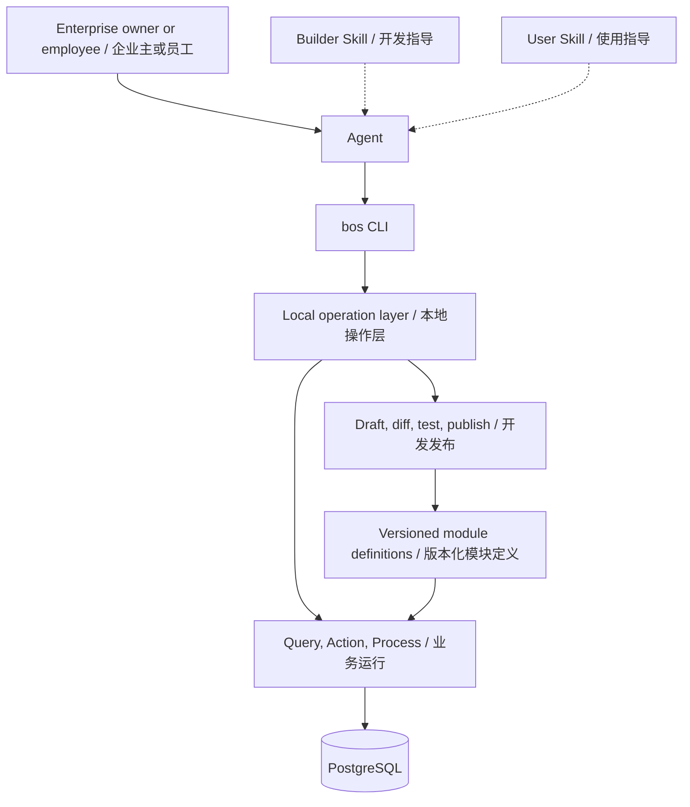

# Architecture / 架构

Two skills, one CLI and one runtime. Skills guide an agent; the operation layer enforces publish permissions and validation. Business runtime enforces action permissions, transactions, tenant scope, idempotency and record/process business versions. 当前实现为本地调用，没有 HTTP 服务。身份由本地合成夹具提供。

The CLI command grammar stays stable. Each published definition includes public capability descriptions, inputs, outputs and roles. Discovery reads the current release and filters capabilities by identity. Adding `expense.submit` changes the module artifact, not the CLI command implementation or User skill.

Builder 发布的实现与能力说明在同一份版本定义中生效。User 通过 `action list/describe/run` 和 `query list/describe/run` 使用新能力。开发验收包含从 User 入口的调用。

Changes are stored separately in `bos_changes`; candidates are not active until published. Tests reconstruct the baseline and candidate in isolated PostgreSQL, retaining synthetic baseline records to check version behavior. Publication requires passing evidence, reruns tests, then compares the expected base under the runtime's release lock. Runtime activation is atomic. Updating the change receipt is a subsequent transaction; crash recovery across those two transactions is not yet guaranteed.

首版支持内置处理器、受限规则表达式，以及声明式 `data.create`。复杂代码仍需修改并测试运行时；生产认证、网络服务、任意代码上传、可靠代码隔离、真实外部系统连接、完整字段级权限和完整失败审计尚未完成。`audit list` 当前展示成功业务动作回执。

Legacy procurement, Builder and billing experiments remain regression fixtures. They are not alternative instructions for agents to bypass the CLI. Existing direct Python APIs are trusted development APIs and do not establish an adversarial server-side security boundary.
