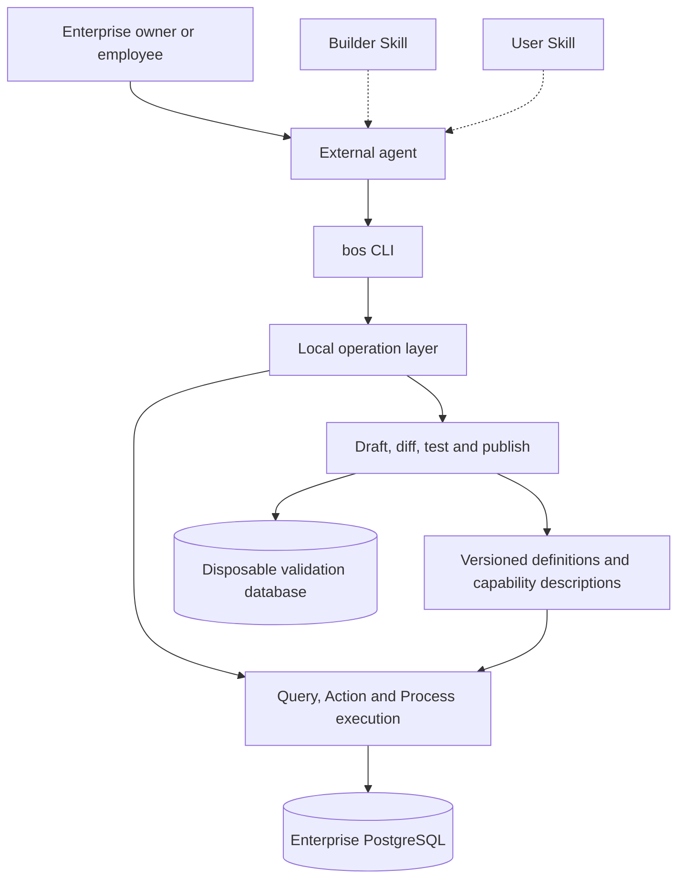

# Technical architecture

English · [简体中文](ARCHITECTURE.zh-CN.md) · [Project introduction](../README.md)

BusinessOS combines two agent skills with one CLI and a shared business runtime. The current implementation is a local Python monolith backed by PostgreSQL. The agent runs outside BusinessOS; there is no embedded model loop or HTTP service.

## Responsibilities

| Layer | Implementation | Responsibility |
|---|---|---|
| Agent guidance | Two `SKILL.md` files | Guide development or business operation through the CLI. |
| CLI | [`businessos/cli.py`](../businessos/cli.py), Python `argparse` | Parse fixed commands and return structured JSON results. |
| Operation layer | [`businessos/service.py`](../businessos/service.py) | Resolve local context, discover capabilities, check inputs, manage changes and validation. |
| Business runtime | [`experiments/procurement/runtime.py`](../experiments/procurement/runtime.py) | Execute authorized business operations, transactions, retries, process steps and version rules. |
| Storage | PostgreSQL through `psycopg` | Persist business rows, definitions, changes, identities, progress and action receipts. |

Skills are instructions, not enforcement. The operation layer checks publishing permissions and validation; runtime code and PostgreSQL enforce the supported business constraints. The local host and direct Python development APIs remain trusted.

## Module contract and discovery

A module groups Objects, Queries, Actions and Processes. Object columns become real SQL columns. Definitions and capability descriptions are stored as JSONB in a release. Action implementations reference registered Python handlers; restricted expressions provide selected rule hooks. The declarative `data.create` handler supports simple new record-creation capabilities.

Public capabilities declare a description, roles, input and output. `bos action list` and `describe` read the current published definition and filter by identity. `bos action run NAME` uses the same command grammar for existing and newly installed capabilities. The input schema supports a documented subset; output schemas are descriptive, not fully enforced.

For example, the expense package declares its table, `expense.submit`, parameter schema and default status. Publishing that package makes the capability available without changing CLI code or the User skill. Complex handlers still require runtime development; arbitrary Python packages cannot be uploaded through the module installer.

## Business execution

An Action call resolves the current identity and release, validates input, then enters the runtime. The runtime checks the current identity again, applies action authorization, and executes in a database transaction. The idempotency key, actor and input hash bind the stored execution receipt. A retry with the same input returns its result; conflicting input is rejected.

Internal Action calls can share the transaction, so a multi-table change such as purchase authorization and budget reservation can roll back together. Cross-module writes are intended to use the owning module's Action; trusted Python handlers still have direct cursor access, so this is not a fully enforced plugin boundary.

Queries run read-only transactions. Business tables carry `tenant_id`, `id` and `release_id`; PostgreSQL row-level security scopes business access by enterprise. Tenants currently share physical tables, with release-defined projections. Comprehensive record- and field-level business permissions are unfinished.

The process interpreter reads durable step state and advances until the next wait or completion. The procurement workflow demonstrates this mechanism. It does not provide a complete general-purpose workflow engine or a production job scheduler. Legacy supplier experiments use a local mock connector, not a real supplier integration.

## Storage and business versions

| Storage | Contents |
|---|---|
| Business tables | Contracts, purchases, approvals, expenses and other declared Objects. |
| `releases` | Immutable release definitions and the current release marker. |
| `bos_changes` | Base definition/hash, candidate, cases, validation evidence and draft status. |
| `actors` | Synthetic identities, roles and active status. |
| `execution` | Successful action receipts and idempotency metadata. |
| Process records | Version, step, status and references needed to continue. |

Contract signing and existing procurement processes load their recorded business version; newly created records use the current release. Execution still checks current authorization. Runtime bookkeeping changes are distinct from module-owned business data.

## Development and publication

1. Export the actual current definition and prepare a candidate plus request-derived acceptance cases.
2. Save a draft bound to the enterprise and a hash of its base definition; inspect the diff.
3. Reconstruct the baseline in disposable PostgreSQL, run synthetic `before` steps, install the candidate, then assert `after` outcomes. Tests do not clone real enterprise data.
4. Record validation against the candidate and cases. Editing a draft invalidates that result.
5. On publication, require owner authority and passing evidence, then rerun validation.
6. Under the release lock, compare the expected base and activate the new definition atomically. Concurrent stale candidates are rejected.

Implementation references and User-facing descriptions are fields in the same released definition, so they become visible together. Existing handler code is part of the runtime deployment rather than uploaded release code. Saving the change's publication receipt is a later transaction; crash recovery between activation and that save remains unfinished.

## Current boundary

The preview uses synthetic local identities and local PostgreSQL trust authentication with fsync disabled. `--identity` is a fixture switch, not production authentication. Restricted expressions run with AST checks in a subprocess with limits; this does not provide robust arbitrary-code isolation. Remote authentication, a network service, arbitrary code upload, comprehensive field permissions and real external connectors are future work.

The older procurement, Builder and billing experiments remain regression fixtures. The legacy Builder wrapper validates a fixed sample; the operational CLI uses explicit acceptance cases. `audit list` currently shows successful business action receipts, not comprehensive failed-operation or deployment audit history.

See the [CLI contract](CLI.md) and [acceptance record](ACCEPTANCE.md) for supported commands and verified behavior.
