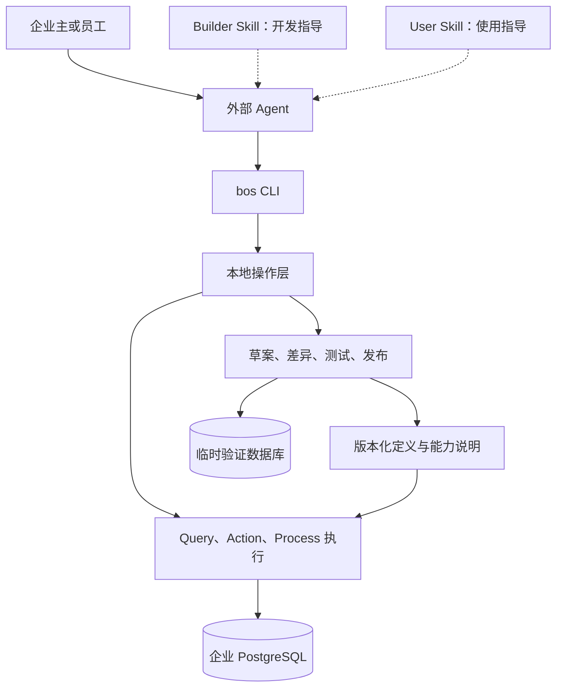

# 技术架构

[English](ARCHITECTURE.md) · 简体中文 · [项目介绍](../README.zh-CN.md)

BusinessOS 由两个 Agent Skill、一套 CLI 和共用业务运行时组成。当前实现为 PostgreSQL 支撑的本地 Python 单体。Agent 在 BusinessOS 外运行，项目内部没有模型调用循环或 HTTP 服务。

## 各层职责

| 层 | 当前实现 | 职责 |
|---|---|---|
| Agent 指导 | 两份 `SKILL.md` | 指导 Agent 通过 CLI 开发系统或办理业务。 |
| CLI | [`businessos/cli.py`](../businessos/cli.py)，Python `argparse` | 解析固定命令，返回结构化 JSON。 |
| 操作层 | [`businessos/service.py`](../businessos/service.py) | 识别本地上下文、发现能力、校验输入、管理变更和验证。 |
| 业务运行时 | [`experiments/procurement/runtime.py`](../experiments/procurement/runtime.py) | 执行授权、业务操作、事务、重试、流程步骤和版本规则。 |
| 存储 | PostgreSQL，通过 `psycopg` 访问 | 保存业务记录、定义、草案、身份、流程进度和动作回执。 |

Skill 是操作指导。发布权限和验证由操作层检查，已支持的业务约束由运行时与数据库执行。当前宿主机及直接 Python 开发接口仍然受信任。

## 模块定义与能力发现

模块组织 Object、Query、Action 和 Process。Object 字段成为真实 SQL 列，业务定义和能力说明以 JSONB 保存到版本中。Action 引用已注册的 Python 处理器；受限表达式用于特定规则扩展。声明式 `data.create` 可以提供简单的新增记录能力。

公开能力声明说明、角色、输入和输出。`bos action list`、`describe` 从当前发布版本读取定义，并按身份过滤；`bos action run NAME` 使用固定命令形式调用已有或新安装的能力。输入仅支持文档规定的 Schema 子集，输出 Schema 目前用于描述，尚未完整强制校验。

例如报销模板声明业务表、`expense.submit`、参数和默认状态。发布后，无需修改 CLI 或 User Skill，用户即可发现和使用它。复杂新处理器仍需开发运行时代码，模块安装器还不能上传任意 Python 包。

## 业务执行

一次 Action 调用先读取当前身份和版本、校验输入，再进入运行时。运行时重新确认身份，检查动作权限，并在数据库事务中执行。幂等键、执行者及输入摘要绑定操作回执；相同输入重试返回原结果，相同键但输入冲突会被拒绝。

内部 Action 调用可以共享事务。例如采购授权与预算占用可在失败时一起回滚。跨模块写入约定通过数据所属模块的 Action；受信任的 Python 处理器仍持有数据库游标，尚未形成完全强制的插件边界。

Query 使用只读事务。业务表包含 `tenant_id`、`id`、`release_id`，由 PostgreSQL 行级安全规则按企业隔离业务访问。企业目前共用物理表，查询投影由版本定义约束。完整的记录级、字段级业务权限尚未完成。

流程解释器读取持久化步骤并推进，直到等待或结束。采购流程验证了这一机制，但当前还没有完整的通用流程引擎或生产任务调度器。旧供应商实验使用本地模拟连接器，不涉及真实供应商。

## 数据与业务版本

| 存储位置 | 内容 |
|---|---|
| 业务表 | 合同、采购、审批、报销等已声明的 Object。 |
| `releases` | 不可覆盖的版本定义及当前版本标记。 |
| `bos_changes` | 基础定义及摘要、候选产物、案例、验证证据和草案状态。 |
| `actors` | 合成身份、角色及有效状态。 |
| `execution` | 成功动作回执和幂等信息。 |
| 流程记录 | 继续执行所需的版本、步骤、状态和关联。 |

合同签约和已有采购流程读取其绑定的业务版本，新记录使用当前版本。每次执行仍检查当前授权。平台运行记录与模块业务数据承担不同职责。

## 开发和发布

1. 导出企业真实的当前定义，根据需求准备候选修改和验收案例。
2. 保存草案，绑定企业和基础定义摘要，检查差异。
3. 在临时 PostgreSQL 中重建基础版本，运行合成的 `before` 步骤，再安装候选版本并检查 `after` 结果。此过程不复制企业真实数据。
4. 将验证结果绑定候选定义和案例；修改草案会使旧验证失效。
5. 发布时检查 owner 权限与验证证据，并重新执行验证。
6. 在发布锁内比较预期基础版本，并原子激活新定义；并发过期草案被拒绝。

实现引用与 User 能力说明属于同一份版本定义，同时生效。已注册处理器代码随运行时部署，尚不是随模块版本上传的代码。发布回执在后续事务保存，版本激活与回执保存之间的崩溃恢复仍需完善。

## 当前边界

预览使用合成本地身份，以及关闭 fsync 的 PostgreSQL 本地信任认证。`--identity` 是测试身份切换，不是生产登录。受限表达式经过 AST 检查，并在带限制的子进程执行；它不提供可靠的任意代码隔离。生产认证、网络服务、任意代码上传、完整字段级权限和真实外部连接器仍待开发。

采购、Builder、计费旧实验继续承担回归验证。旧 Builder 包装器验证固定示例，正式的本地操作入口使用 CLI 和显式验收案例。`audit list` 目前只展示成功业务动作回执，尚不构成完整的失败操作或发布审计。

可用命令见 [CLI 约定](CLI.md)，已验证行为见[验收记录](ACCEPTANCE.md)。
